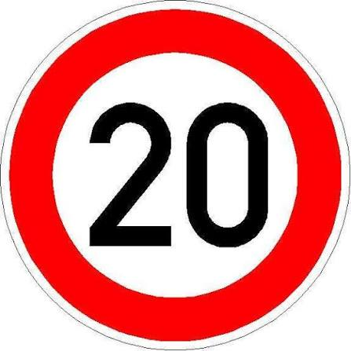

# Traffic Sign Classification (GTSRB)

ResNet-18 classifier for the German Traffic Sign Recognition Benchmark (43 classes), served with
FastAPI and a Streamlit UI that shows a confidence score and flags uncertain predictions.

**Stack:** PyTorch, ResNet-18 (transfer learning), FastAPI, Streamlit.




## Method
- **Leak-free split:** GTSRB has ~30 near-identical frames per physical sign, so a random split
  inflates scores. Train/validation use `StratifiedGroupKFold` grouped by physical sign
  (1,307 signs; none shared between train and validation).
- **Imbalance:** largest class has ~10.7x more images than the smallest (2250 vs 210).
- **Training:** 64x64 inputs, rotation + colour-jitter augmentation (no horizontal flip, which would
  swap left/right signs), Adam + cosine schedule, best epoch chosen on validation macro-F1.
- **Experiment:** baseline vs inverse-frequency class weighting, same seed and split.

## Results (official GTSRB test set, 12,630 images)
| | Accuracy | Macro-F1 | Minority-class F1 |
|---|---|---|---|
| Baseline | 0.9797 | 0.9679 | 0.9479 |
| Class-weighted | 0.9818 | 0.9719 | 0.9422 |

Class weighting gave a small overall gain; the minority-class difference is within noise
(single seed, 6 minority classes), so no minority-class improvement is claimed.

## Error audit (weighted model, 230 errors / 12,630)
- Errors concentrate in visually similar pairs, mostly red-bordered warning triangles
  (bumpy road -> road work, pedestrians -> right-of-way, traffic signals -> road work) and
  speed-limit digits (60 -> 80 km/h).
- Confidence is informative: mean 0.995 on correct vs 0.746 on wrong predictions. A 0.6 threshold
  flags 29.6% of errors for review while flagging 0.4% of correct predictions.

## Limitations
The model classifies a cropped sign image of one of the 43 German sign classes. It does not locate
signs in full scenes, and signs from other countries are out of distribution (they are flagged as
low-confidence).

## Run locally
```bash
pip install -r requirements.txt
# place weighted.pt (trained in notebooks/) in models/
uvicorn app.main:app --port 8000
streamlit run app/streamlit_app.py     #run this in a second terminal
```
API docs: http://localhost:8000/docs. `POST /predict` returns class, confidence, top-3 and an
`uncertain` flag.

## Training
See `notebooks/` (Kaggle, GPU). Metrics for both runs are in `results/`.